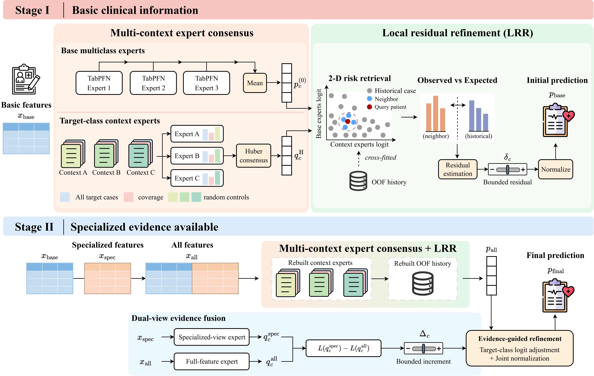

# TS-MCER: A Two-Stage Framework for Clinical Diagnosis Prediction via Multi-Context Expert Consensus and Evidence-Guided Refinement



TS-MCER is a **TabPFN-based framework for staged multiclass diagnosis prediction** as clinical information becomes available. 

## Pipeline

```text
CSV + target column
  -> Shared train / validation / test split
  -> Stage I: basic features
     -> Cross-fitted TabPFN experts, consensus, and local residual refinement
     -> Validation-based parameter selection and evaluation
  -> Stage II: complete features
     -> Rebuilt experts and OOF memory, consensus, and local residual refinement
     -> Dual-view evidence fusion, validation-based selection, and evaluation
```

## Repository Layout

```text
.
|-- README.md
|-- LICENSE
|-- requirements.txt               # Project dependencies
|-- main.py                         # Main entry point
|-- config.json                     # Experiment settings and search grids
|-- assets/                         # Framework figure
|-- configs/                        # Stage configurations and search examples
|-- ovr/                            # Method implementation
`-- tests/                          # Regression checks
```

## Installation

### 1. Download and configure TabPFN

Follow the [official TabPFN installation guide](https://github.com/PriorLabs/TabPFN#installation) and download `tabpfn-v3.5-20260909.safetensors` from the [official model repository](https://huggingface.co/Prior-Labs/tabpfn_3_5/tree/main). In [config.json](config.json), update the existing `model.checkpoint` field with the absolute path to the downloaded file:

```json
{
  "model": {
    "checkpoint": "/path/to/tabpfn-v3.5-20260909.safetensors"
  }
}
```

### 2. Install project dependencies

Using Python 3.11 or newer, run the following command from the repository root to install [requirements.txt](requirements.txt):

```bash
python -m pip install -r requirements.txt
```

## Datasets

- **MIMIC-IV v3.1:** [PhysioNet](https://physionet.org/content/mimiciv/3.1/)
- **Dermatology:** [UCI Machine Learning Repository](https://archive.ics.uci.edu/dataset/33/dermatology)

## Usage

The standard workflow evaluates both stages using the provided configuration files. Replace their placeholder column names with your actual features:

| Configuration | Fields to fill in |
|---|---|
| [configs/stage1.json](configs/stage1.json) | `data.features`: basic feature columns |
| [configs/stage2.json](configs/stage2.json) | `data.features`: complete feature columns, including Stage I features; `dual_view_evidence_fusion.specialized_columns`: specialized-view columns, a nonempty proper subset of the complete features |

Both files inherit the checkpoint path, split settings, missing-value rules, and search grids from [config.json](config.json). Set the checkpoint path there once, as described in Installation. Stage I ends at local residual refinement; Stage II includes dual-view evidence fusion. Each stage builds its own experts and OOF memory and selects parameters on validation data.

Feature columns must be numeric; encode categorical feature values before running.

Run the stages in order using the same CSV and target column, with separate output directories:

```bash
python main.py --csv /path/to/input.csv --label target --config configs/stage1.json --output ../result_stage1
python main.py --csv /path/to/input.csv --label target --config configs/stage2.json --output ../result_stage2
```

| Argument | Meaning |
|---|---|
| `--csv` | Input CSV path |
| `--label` | Target column name; all distinct values are included as classes |
| `--config` | Stage configuration, merged with the shared defaults in `config.json` |
| `--output` | New output directory; defaults to `../result/` beside the source directory |

`data.missing_values` treats the token `"-1"` as missing by default. If `-1` is a valid feature value, remove it from that list in `config.json`: `["", "?", "NA", "NaN", "nan", "null"]`. Both stages inherit this setting.

The default search grids in [config.json](config.json) match [configs/search_example.json](configs/search_example.json). Stage I evaluates 384 refinement candidates. Stage II evaluates 384 refinement candidates, then 54 fusion candidates. Edit the shared grids in `config.json` to change the search space for both stages.

Each stage automatically evaluates its predictions, prints test metrics in the terminal, and saves `<output>/result.json`: `metrics.train_oof` for training out-of-fold scores, `metrics.val` for validation scores, and `metrics.test` for test scores, including accuracy, macro-F1, and macro OvR AUROC.
